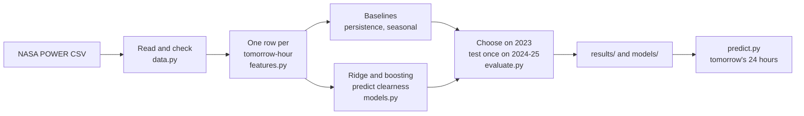
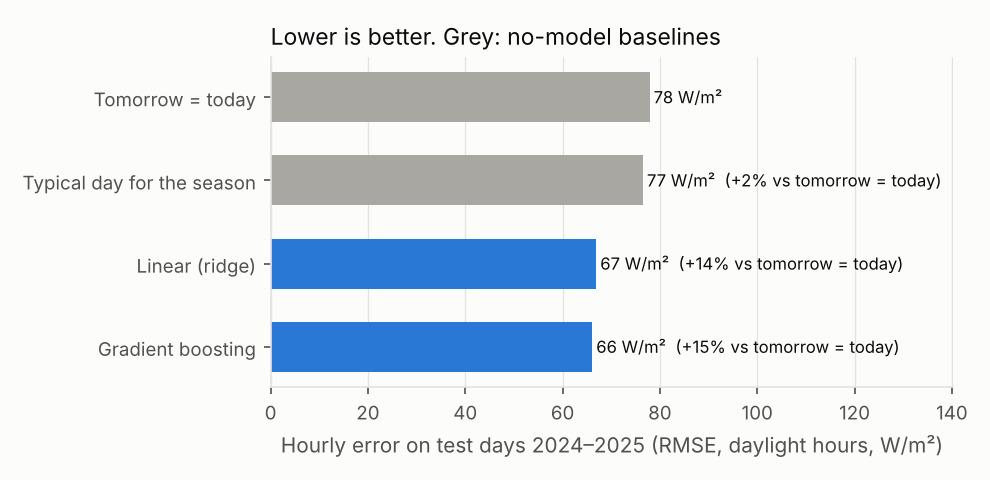
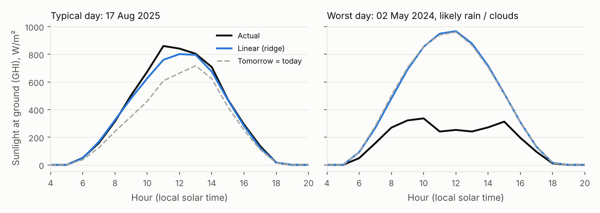
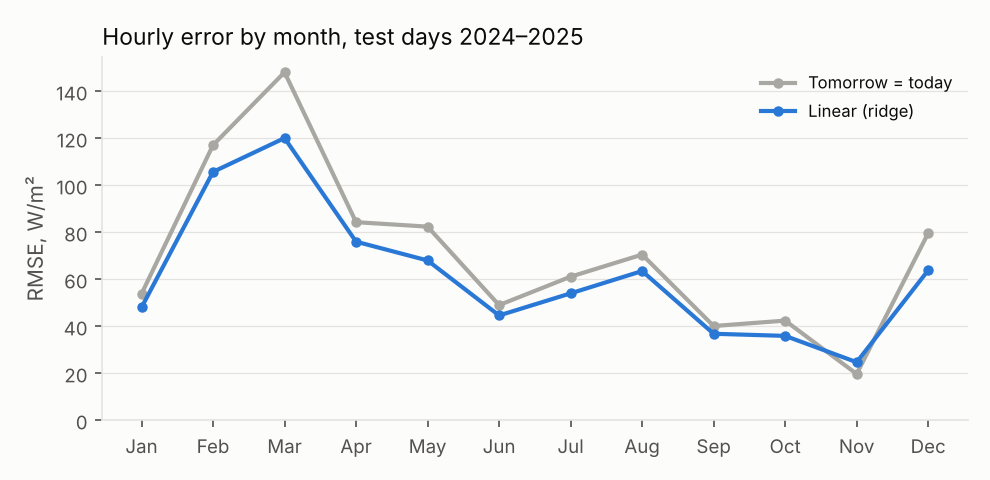

# SolPredict: day-ahead solar forecasting for Ibri, Oman

Every evening, forecast how much sunlight will reach the ground at Ibri for each hour of tomorrow, and what that means for a 500 MW solar plant. Built on 11 years of free NASA POWER data.

| Submission | |
|---|---|
| Candidate | Alhanoof Al Buraiki |
| Lane | Machine learning |
| Project | SolPredict: day-ahead solar forecasting for Ibri, Oman |
| Outcome | Complete, reproducible workflow: data checks, two baselines, two models, held-out test, error analysis, inference command |
| Compute | Any laptop; the full run takes about 10 seconds on 2 CPUs, no GPU |

**Result.** On the test years 2024–2025, the model cuts the hourly forecast error by **14%** compared with "tomorrow will be like today" (RMSE 67 vs 78 W/m²). For a 500 MW plant that is an average error of **18.4 MW instead of 20.1 MW** per daylight hour, using a deliberately simple conversion that understates a real plant's output by about a third (section 6.4). The big misses are storms: of the 50 worst days, 49 were clouds or rain, which the model cannot see coming because it uses no weather forecast. That is its main limitation and the first thing I would add.

---

## 1. Project and lane

**Lane:** Machine learning. **Route:** forecasting (regression on time series).

**Problem.** Oman is building gigawatts of solar to reach 30% renewable electricity by 2030, while peak demand on the main grid is projected to grow about 7% a year, from 7.5 GW (2024) to 12.2 GW (2031) (Nama, reported by Oman Observer). Solar output changes with the weather, so the grid operator has to plan each day's gas generation around how much sun tomorrow will bring. A better day-ahead forecast means less gas held in reserve "just in case".

**Intended user.** An energy planner at the grid operator, or a solar plant operator, who needs tomorrow's expected solar output each evening.

**Main workflow.**

1. At the end of day D, take that day's hourly data: sunlight, clear-sky sunlight, temperature, humidity, wind, rain.
2. For each hour of day D+1, predict the **clearness**: the share of top-of-atmosphere sunlight that will reach the ground.
3. Multiply by the top-of-atmosphere sunlight for that hour, which is pure astronomy and known in advance.
4. Output 24 hourly values in W/m² and the matching output of a 500 MW plant.

Predicting clearness instead of raw sunlight separates the weather (what the model must learn) from the sun's position (which is known exactly).

---

## 2. Requirements and status

| # | Acceptance criterion | Result | Status | Evidence |
|---|---|---|---|---|
| R1 | Task, user, data source and rights, target and metric defined | Sections 1 and 3; NASA acknowledgement in `NOTICE` | Met | [data card](docs/data_card.md) |
| R2 | Data checked and documented | 96,432 of 96,432 hours, no missing values, no sun at night, peak at 12:00 | Met | `results/data_checks.json` |
| R3 | No leakage: features only use information available when the forecast is made | Features for day T use day T−1 and earlier plus the sun's position; tested | Met | `tests/test_pipeline.py` |
| R4 | Chronological train / validation / test, test used once | Train 2015–2022, choose on 2023, test 2024–2025 | Met | `src/solpredict/evaluate.py` |
| R5 | Beat both no-model baselines on the test years | +14% vs "tomorrow = today", +13% vs "typical day for the season" | Met | `results/summary.csv` |
| R6 | Error expressed in terms an operator uses | 18.4 MW average hourly error on a 500 MW plant (simple conversion, understates a real plant by about a third); 0.40 kWh/m² daily energy error | Met | `results/metrics.json` |
| R7 | Error analysis with failure cases | Errors by month; 10 worst days with likely cause; storms and November explained | Met | section 6 |
| R8 | Inference with sample input and output; model integrity | `solpredict predict` on a committed sample; refuses a model whose checksum changed | Met | `samples/`, `tests/test_predict.py` |
| R9 | Reproducible: config, seed, versions, data version | One config file, seed 42, pinned versions, committed data with checksum | Met | `src/solpredict/config.py`, `requirements.txt`, `data/manifest.json` |
| R10 | Independent cross-check of data and outputs | NASA sunlight within 7% of PVGIS for the same years; MW conversion compared with Ibri II's expected output | Met | [verification report](docs/verification.md) |
| R11 | Sees storms coming | Not possible without weather-forecast inputs | **Not met** | section 6.2 |

---

## 3. Setup and run

**Requirements:** Python 3.11+ (results produced with 3.13.18) and `git`. No internet is needed after cloning: the data are in the repository.

```bash
git clone https://github.com/hnf02/SolPredict.git
cd SolPredict
git checkout v1.0.0
python -m venv .venv && source .venv/bin/activate
pip install -r requirements.txt
pip install -e .
```

| Step | Command | Expected result |
|---|---|---|
| Check the data file | `solpredict verify` | `data/ibri_hourly.csv.gz matches data/manifest.json` |
| Data sanity checks | `solpredict check` | the layer 1 table in docs/verification.md |
| Train and evaluate | `solpredict run` | `chosen on validation: ridge` and the score table below; writes `results/` and `models/` |
| Forecast tomorrow | `solpredict predict --input samples/sample_input.csv` | 24 hourly values for 1 Jan 2026, 4.30 kWh/m², peak 350 MW |
| Tests | `python -m pytest -q` | 14 passed |
| Full verification audit | `solpredict audit` | about 30 s; writes `results/audit.json` and two figures; summarised in [docs/verification.md](docs/verification.md) |
| Re-fetch from NASA (optional) | `solpredict download` | needs internet; NASA may have revised recent values, so the checksum can differ |

Expected output of `solpredict run`:

```
chosen on validation: ridge
         period    forecast  mae_wm2  rmse_wm2  bias_wm2  mae_mw  daily_energy_mae_kwh_m2  hours  days  skill_vs_persistence
validation_2023 persistence    39.23     72.16      0.05   19.51                    0.408   4516   365                0.0000
validation_2023    seasonal    39.99     68.04     15.05   19.85                    0.457   4516   365                0.0571
validation_2023       ridge    35.11     61.72      2.05   17.44                    0.365   4516   365                0.1447
validation_2023    boosting    35.84     62.34      0.10   17.81                    0.389   4516   365                0.1361
 test_2024_2025 persistence    40.42     77.94     -0.02   20.07                    0.428   9043   731                0.0000
 test_2024_2025    seasonal    42.48     76.55     16.72   21.10                    0.493   9043   731                0.0178
 test_2024_2025       ridge    36.96     66.96      2.40   18.36                    0.399   9043   731                0.1409
 test_2024_2025    boosting    36.64     66.14      3.80   18.21                    0.399   9043   731                0.1514
```

`persistence` is "tomorrow = today" and `seasonal` is "typical day for the season". `mae_mw` is the error for the example 500 MW plant; `skill_vs_persistence` is the share of the persistence error removed.

**Input format for `predict`:** a NASA POWER hourly CSV (as downloaded from the site, header included) with at least one complete day. It forecasts the day after the last complete day.

---

## 4. Demo and access

No hosted service is needed; everything runs locally in a few seconds.

**Walkthrough (about 2 minutes):**

1. `solpredict run` trains both models, picks one on 2023, scores 2024–2025 and draws the figures in `results/`.
2. Open `results/test_scores.png`: both models against both baselines.
3. Open `results/example_days.png`: a typical day and the worst day.
4. Run a forecast:

```bash
solpredict predict --input samples/sample_input.csv
```

```
      date  hour_lst  ghi_forecast_wm2  plant_mw_forecast
2026-01-01         7              59.8               29.9
2026-01-01        12             700.0              350.0
2026-01-01        17              16.7                8.3
...
2026-01-01: 4.30 kWh/m² of sunlight expected; peak plant output 350 MW of 500 MW
```

(Rows shortened here; the full 24 rows are in `samples/expected_output.csv`.) The sample input is the last two days of the data, 30–31 Dec 2025, so this is a genuine forecast for a day the model never saw.

**Reviewer access:** the repository is all that is needed. If it is private, the owner grants read access on GitHub.

---

## 5. Architecture and decisions



| File | Job |
|---|---|
| `config.py` | Site, parameters, split dates, plant size, seed |
| `data.py` | Read NASA's CSV, save the combined file with a checksum, sanity checks, re-download |
| `features.py` | Turn hourly data into (forecast day, hour) rows; the two baselines |
| `models.py` | Ridge and gradient boosting; clearness → GHI |
| `evaluate.py` | Split, scores, model choice, test, error analysis |
| `predict.py` | Forecast tomorrow from a CSV with the saved model |
| `plots.py`, `cli.py` | Figures; the `solpredict` command |

**Key decisions**

| Decision | Alternative | Why |
|---|---|---|
| Predict clearness, then multiply by the known sun position | Predict sunlight in W/m² directly | Separates weather from astronomy; the model only has to learn the weather. |
| Two no-model baselines | One baseline, or none | "Tomorrow = today" is hard to beat in a sunny desert; "typical day for the season" shows the value of using recent data. I first tried spreading yesterday's *daily* clearness over every hour: it was 19% worse than persistence, because mornings and evenings are always less clear (the sun shines through more air). |
| Choose the model on 2023, test 2024–2025 once | Pick the better model on the test years | Gradient boosting is 0.8 W/m² better on test, but ridge won on validation. Switching after seeing test results would make the test score untrustworthy, and the simpler model is easier to explain. |
| Commit the data file (1.5 MB) | Download at run time | NASA can revise recent values; committing guarantees the same numbers for every reviewer. The download command is kept. |
| End-of-day forecast, one site | Several sites or forecast times | Keeps the project explainable in two days; the method extends to other sites. |

---

## 6. Verification and limitations

### 6.1 Results



| Forecast | Validation 2023 RMSE | Test 2024–2025 RMSE | Skill vs "tomorrow = today" (test) | 500 MW plant, average hourly error |
|---|---:|---:|---:|---:|
| Tomorrow = today | 72.2 | 77.9 | 0% | 20.1 MW |
| Typical day for the season | 68.0 | 76.6 | +2% | 21.1 MW |
| **Ridge (chosen)** | **61.7** | **67.0** | **+14%** | **18.4 MW** |
| Gradient boosting | 62.3 | 66.1 | +15% | 18.2 MW |

What the linear model learnt (standardised weights): yesterday's clearness at the same hour matters most (+0.090), then the sun's height (+0.070; a higher sun passes through less air), then yesterday's temperature (−0.028) and haze (+0.013). Details in the [model card](docs/model_card.md).

### 6.2 Where it fails



* **Storms.** On 2 May 2024 a storm cut sunlight to 2.8 kWh/m², against 6.9 forecast; the model and persistence made the same mistake because neither can see tomorrow's weather. Of the 50 worst test days, 49 were clouds or rain (1 dust or haze), and 74% were over-forecasts. The worst 10% of days cause 40% of all daily error. **Next step:** add weather-forecast inputs.
* **November.** Skies are so steady that "tomorrow = today" wins (RMSE 19.7 vs 24.7 W/m²): the model pulls towards the long-term average and forecasts about 15 W/m² too little at almost every hour.
* **February and March** are the hardest months (model RMSE 106 and 120 W/m²).



I had expected dust to be a major source of error in Oman. In this data it is not: clouds and rain dominate the big misses. That may partly be because satellite estimates for a ~100 km cell smooth out local dust events.

### 6.3 Limitations

* Satellite and weather-model estimates for a ~100 km cell, not measurements at a plant.
* No weather-forecast inputs, so storms are missed (6.2).
* MW figures use a simple conversion (rated output at 1,000 W/m² of horizontal sunlight, linear below). It implies a 25% capacity factor, while Ibri II expects about 36.5%, so it understates a real plant by about a third. Treat MW numbers as scale, and the W/m² results as the measure of forecast quality.
* The "likely cause" of a bad day is a rule of thumb from the data, not an observed weather report.
* One site, one forecast time.
* Years differ: NASA's annual sunlight fell from 2,244 kWh/m² (2015) to 2,105 (2024). The seasonal baseline, learnt on 2015–2022, therefore over-forecasts 2024–2025; whether the dimming is real or a satellite-product change cannot be told from this data.

### 6.4 How it was verified

Five layers of checks, all re-runnable: `solpredict audit` (layers 1, 2, 4, 5) and `python -m pytest` (layer 3). Full report with figures: **[docs/verification.md](docs/verification.md)**.

| Layer | Main evidence | Verdict |
|---|---|---|
| 1. Data | 96,432 / 96,432 hours; 0 missing values; 0 hours of sun at night; never above top-of-atmosphere; brightest hour 12:00 LST; summer and winter weeks plotted | Pass |
| 2. Leakage | Multiplying 20 real forecast days by 3 left their features unchanged; split is chronological; a model trained on **shuffled answers** scored 108.9 W/m² vs 61.7 for the real model, so nothing leaks | Pass |
| 3. Code | 14 tests with hand-checkable answers (persistence, skill score, no look-ahead, live = training features, model checksum, LST-only input) | Pass |
| 4. Results | Beats persistence in 11 of 12 months; best days are clear days, worst days are storms; NASA sunlight within 7% of PVGIS for the same years; MW conversion understates Ibri II by about a third (disclosed above) | Pass, with findings |
| 5. Reproducibility | Exact download link and date in `data/manifest.json`; data checksum; second run byte-identical; fresh clone reproduced every number, the model file and the sample forecast | Pass |

One change was made after test scores were visible: the second baseline was replaced (layer 2 of the report explains why). It does not affect the model, its choice, or its skill against persistence.

---

## 7. Credits and contribution

**Data.** NASA POWER Project: "These data were obtained from the NASA Langley Research Center (LaRC) POWER Project funded through the NASA Earth Science/Applied Science Program." Radiation from CERES SYN1deg, weather from MERRA-2. See `NOTICE`.

**Context sources.** Oman Observer (Nama demand outlook, March 2026; renewables share, June 2026).

**Libraries.** NumPy, pandas, scikit-learn, Matplotlib, joblib, pytest. No pretrained models or reused project code.

**My contribution.** I chose the problem, the site and the data source. I directed the work and made the final decisions on the approach: predicting clearness, the two baselines, the chronological split, and keeping ridge as the chosen model. I reviewed and ran the code, checked the results, and can explain every part of the workflow.

**AI assistance.** The code was written with AI assistance: I directed it and reviewed it, and AI tools wrote parts of it. All documentation (this README, the model card, the data card and the verification report) was written by AI and reviewed by me.

**Licence.** Code: Apache 2.0 (`LICENSE`).


