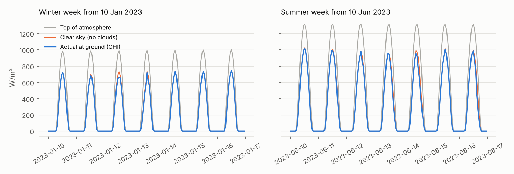
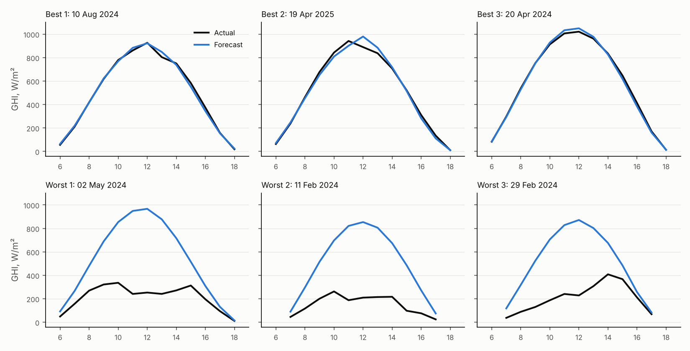

# Verification report

Five layers of checks. Layers 1, 2, 4 and 5 are re-run by `solpredict audit` (about 30 seconds; results in `results/audit.json`); layer 3 is `python -m pytest`.

| Layer | Question | Verdict |
|---|---|---|
| 1. Data | Is the data what we think it is? | Pass |
| 2. Leakage | Does any feature see the day being forecast? | Pass |
| 3. Code | Do the calculations give hand-checkable answers? | Pass (14 tests) |
| 4. Results | Do the results make physical and practical sense? | Pass, with two findings (MW conversion understates a real plant; 2024 was a dim year) |
| 5. Reproducibility | Does someone else get the same numbers? | Pass |

---

## Layer 1: the data

| Check | Expected | Found |
|---|---|---|
| Rows | 96,432 hours in 2015–2025 | 96,432; 0 gaps; 0 duplicates |
| Missing values (NASA writes −999) | Count and handle them | 0 in every column; the reader still converts −999 to missing (tested) |
| Time standard | Stated in the file header | LST (local solar time); the brightest hour on average is 12:00, as it should be |
| Sun at night | None | 0 hours with sunlight > 1 W/m² when the top-of-atmosphere value is 0 |
| Ground sunlight above top-of-atmosphere | Impossible | 0 hours |
| Ground sunlight above clear-sky by > 50 W/m² | Rare | 0 hours |
| Maximum | About 1,000–1,100 W/m² in a desert | 1,104 W/m² |

Note on clock time: Ibri is 3.48° west of the 60°E meridian that Oman's clock time (UTC+4) follows, so solar noon at Ibri is about 14 minutes after 12:00 Oman time (plus up to ±16 minutes over the year). The forecasts are in local solar time; add about 14 minutes for clock time.

Visual check (`results/audit_weeks.png`): a winter week and a summer week. Ground sunlight always sits under the clear-sky curve, which sits under top-of-atmosphere; winter peaks are lower (about 700 W/m²) than summer peaks (about 1,000 W/m²); one January day shows a cloud dip.

## Layer 2: no leakage

The forecast is made at the end of day D for every hour of day D + 1. Every feature may use day D or earlier, plus the sun's position, which is pure astronomy.

| Check | How | Result |
|---|---|---|
| Features ignore the forecast day | In the **real** data, multiplied every value of 20 random forecast days by 3 and rebuilt the features | Features for those days unchanged; their target did change |
| Same rule in tests | `test_features_do_not_use_the_forecast_day` (synthetic data) | Pass |
| Chronological split | Dates of each part | Train 2 Jan 2015 – 31 Dec 2022; validation 2023; test 2024–2025; no overlap |
| Seasonal baseline learnt from training years only | `test_seasonal_baseline_uses_only_training_days` | Pass |
| Shuffled-answer control | Trained the same model on training data with the answers randomly shuffled, scored on 2023 | RMSE 108.9 W/m², far worse than the real model (61.7), persistence (72.2) and the seasonal baseline (68.0). A leak would let the shuffled model still score well. |

**Decisions made after seeing test results (disclosed).** The pipeline was run several times; it is deterministic and the model choice (ridge, on 2023) never changed. One thing was changed after the test scores were visible: the second baseline. The first version (yesterday's daily clearness spread over every hour) was replaced by "typical day for the season" because it was a poor baseline (19% worse than persistence). This changes neither the model nor its score, and the headline skill is measured against persistence, which was never changed.

## Layer 3: code checked against known answers

`python -m pytest -q` → 14 passed.

| Test | What it proves |
|---|---|
| `test_reader_parses_header_time_standard_and_missing_values` | NASA's format is read correctly, including LST and −999 |
| `test_persistence_is_yesterday_same_hour` | The persistence forecast is exactly yesterday's value at that hour |
| `test_features_do_not_use_the_forecast_day` | No look-ahead (see layer 2) |
| `test_live_forecast_rows_match_training_rows` | A live forecast uses exactly the features the model was trained on |
| `test_skill_score_edges` | Skill is 0 when equal to persistence, 1 when perfect, 0.2 for a 20% smaller error |
| `test_scores_on_a_known_example` | MAE, bias and daily energy error on a 3-value example worked out by hand |
| `test_split_is_chronological` | Train < validation < test, nothing left out |
| `test_night_hours_are_not_scored` | Night hours are excluded from training and scores |
| `test_seasonal_baseline_uses_only_training_days` | The seasonal baseline cannot see test days |
| `test_sample_forecast_matches_expected` | The committed model reproduces the committed sample forecast |
| `test_forecast_is_for_the_next_day_and_zero_at_night` | 24 values for the right day, zero at night, never above plant size |
| `test_tampered_model_is_refused` | A model file that does not match its checksum is not used |
| `test_input_without_a_complete_day_is_rejected` | Too little input gives a clear error, not a silent forecast |

## Layer 4: do the results make sense?

**By month.** The model beats "tomorrow = today" in 11 of 12 months. The exception is November, the steadiest month, where persistence is hard to beat. The hardest months are February and March (cloud and rain from winter weather systems). See `results/error_by_month.png`.

**Best and worst days** (`results/audit_best_worst.png`). The three best test days (10 Aug 2024, 19 Apr 2025, 20 Apr 2024) are clear days forecast almost exactly. The three worst (2 May, 11 Feb, 29 Feb 2024) are all cloudy or rainy days forecast as sunny:

| Day | Actual (kWh/m²) | Forecast | Clearness | Rain (mm) |
|---|---:|---:|---:|---:|
| 2 May 2024 | 2.76 | 6.87 | 0.25 | 24.5 |
| 11 Feb 2024 | 1.65 | 5.59 | 0.21 | 1.0 |
| 29 Feb 2024 | 2.28 | 5.67 | 0.26 | 0.5 |

**Independent cross-check 1: is NASA's sunlight level right?** PVGIS (European Commission, PVGIS-SARAH satellite data 2005–2016) gives 2,547.6 kWh/m² per year on a panel at Ibri tilted 25° towards the south (Marzouk, *Sustainability* 2021). Converting NASA's horizontal data to the same tilted panel (Erbs and isotropic-sky models, in `audit.py`):

| | kWh/m² per year, 25° tilted panel |
|---|---:|
| PVGIS-SARAH, 2005–2016 | 2,548 |
| NASA POWER, 2015–2016 (overlapping years) | 2,362 (−7.3%) |
| NASA POWER, 2015–2025 average | 2,311 (−9.3%) |

A 7% gap between two satellite products, plus an approximate tilt conversion, is within the usual disagreement; nothing is wildly off. NASA's data are on the low side, so absolute energy figures here are likely conservative.

**Finding: the years differ.** NASA's annual horizontal sunlight falls from 2,244 kWh/m² (2015) to 2,105 (2024), the dimmest year in the data, then 2,169 (2025). This explains why the seasonal baseline, learnt from 2015–2022, over-forecasts in 2024–2025 (bias +16.7 W/m²). Whether this is a real change in haze or cloud or a change in the satellite product cannot be told from this data alone.

**Independent cross-check 2: are the megawatt figures realistic?** Ibri II (500 MW) is expected to produce about 1,600 GWh per year (Oman Observer), a capacity factor of about 36.5%. The simple conversion used here (rated output at 1,000 W/m² of horizontal sunlight, linear below) gives a capacity factor of 25.0%.

**Finding: the MW conversion understates a real plant by about a third.** Utility plants tilt their panels or track the sun, so they collect much more than horizontal sunlight (the same paper puts Ibri at 3,264 kWh/m² per year with vertical-axis tracking, against 2,548 for a fixed panel); the plant's 500 MW rating may also be measured differently from the simple conversion. The MW numbers in this project are therefore an illustration of scale, not plant output; the W/m² results are the real measure of forecast quality.

## Layer 5: reproducibility

| Check | Result |
|---|---|
| Data source and date recorded | `data/manifest.json`: the exact NASA POWER link used, downloaded 1 November 2026 |
| Data checksum | sha256 of the data in `data/manifest.json`; `solpredict verify` passes |
| Data committed | Yes (1.5 MB), because NASA may revise recent values |
| Random seed | 42 (`config.py`); the chosen ridge model has no randomness |
| Package versions | Pinned in `requirements.txt` |
| Same numbers on a second run | `metrics.json`, `summary.csv` and `model.joblib` byte-identical (audit re-runs the pipeline) |
| Fresh clone | New folder and virtual environment, following the README: data verified, same metrics, same model file and same sample forecast; 14 tests passed (re-run after the audit and the LST input check were added) |

## References for the cross-checks

* O. A. Marzouk, "Lookup Tables for Power Generation Performance of Photovoltaic Systems Covering 40 Geographic Locations (Wilayats) in the Sultanate of Oman, with and without Solar Tracking, and General Perspectives about Solar Irradiation", *Sustainability* 13(23), 13209, 2021, doi:10.3390/su132313209: https://www.mdpi.com/2071-1050/13/23/13209
* "Ibri 2 solar power plant officially launched", Oman Observer: https://www.omanobserver.om/article/1113166/business/energy/ibri-2-solar-power-plant-officially-launched-today
